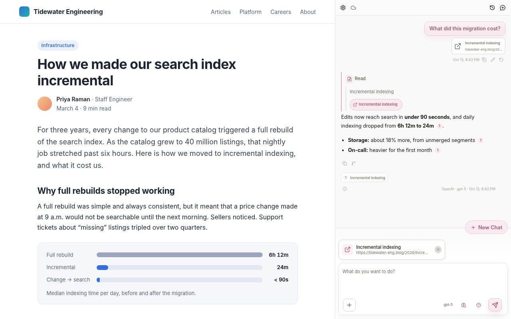
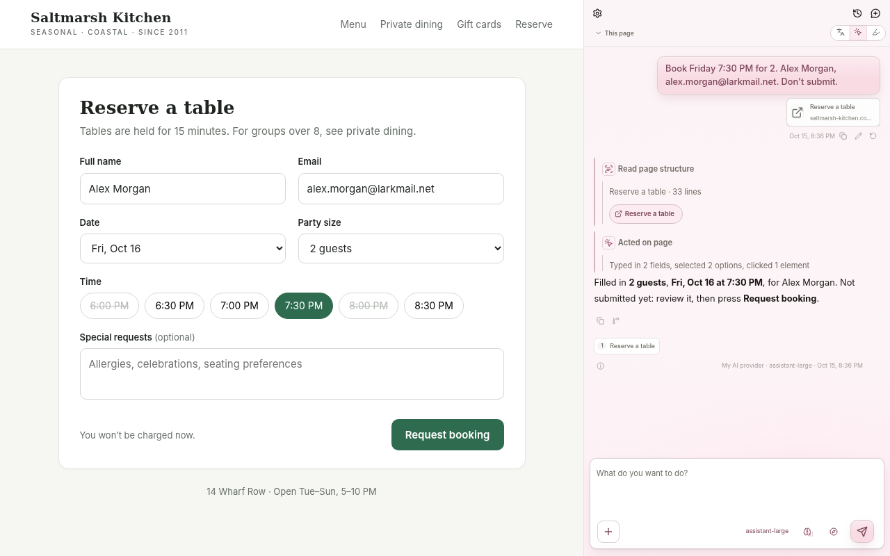
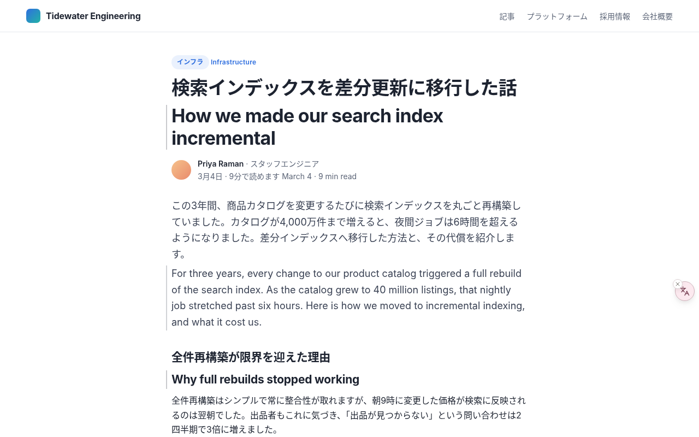
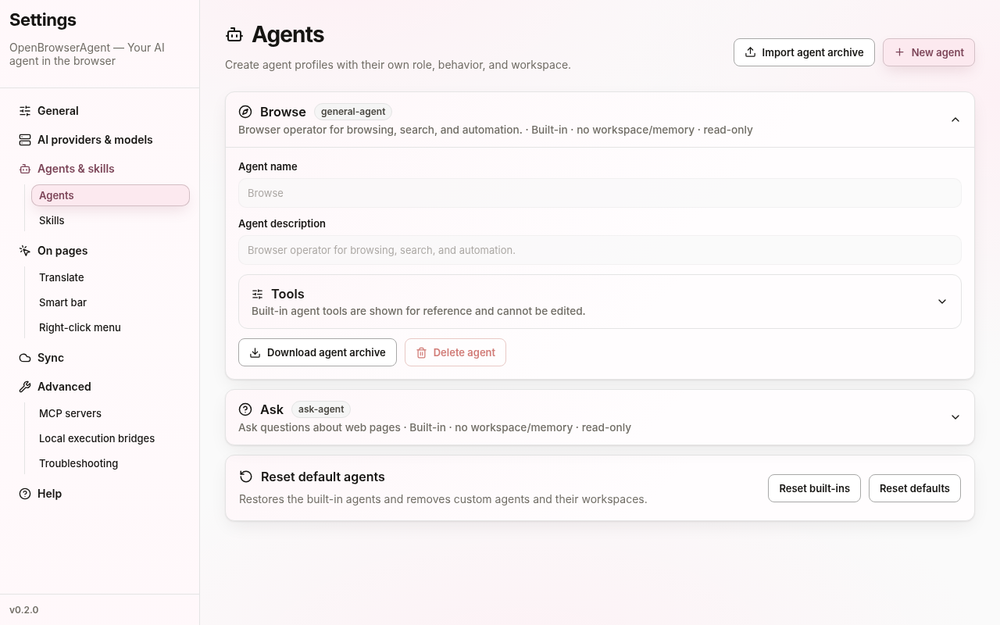
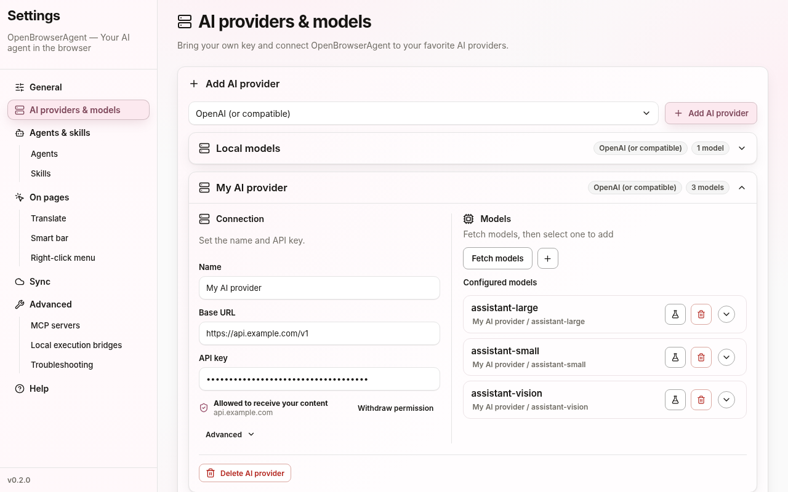

<p align="center"></p>

# OpenBrowserAgent

OpenBrowserAgent puts an AI agent in your browser's side panel. Ask about the page you're on, research a question across tabs, or hand over a task: the agent reads pages, clicks, types and moves between tabs while you watch every step. It also translates web pages and video subtitles, and adds quick actions to text you select.

You bring your own model, from a cloud provider with your own API key or running on your own computer. OpenBrowserAgent has no account and no server of its own.

<p align="center">
  
</p>

## What it does

### Chat with pages in the side panel

- Ask about the current page, several tabs, selected text, a page element or files you attach. Answers stream in and link back to their sources.
- Replies render Markdown, code with syntax highlighting, math and Mermaid diagrams (with SVG and PNG download).
- Keep your chat history: rename, delete, export or import chats, and queue more messages while a reply is still running.

### Let the agent work in the browser

- The built-in **Browse** agent reads pages, opens and switches tabs, clicks, types, fills in forms, picks options, scrolls and edits pages in place. The **Ask** agent reads pages but never operates the browser.
- It notices what changed after each step, takes screenshots (also of one element, enlarged), searches inside long pages and files, reads PDF and Office documents, runs web searches, and downloads or saves files for you.
- For exact numbers it can write JavaScript and run it in a sandbox on your device that has no network access.
- In Chrome it can record a tab's failed requests and console errors while you reproduce a problem, with credentials removed before the model sees them.
- It works on its own tab, so you can keep browsing while it runs, and it asks you when it is unsure.
- Create your own agents with their own instructions, tools, model and an optional workspace with memory. Agents can hand work to sub-agents that run in the background. Agents can be imported and exported.

### Translate pages and video subtitles

- Translate a whole page from the toolbar menu, the translate button on the page edge, the right-click menu or a keyboard shortcut (Alt+A, Control+Shift+A on macOS). The translation sits under each paragraph or replaces it, keeping the page's layout and font; code and form fields are left alone.
- Choose the engine: the browser's on-device translator (the default, where the browser has one), your AI model, or Google's or Microsoft's free translation.
- Translate a video's subtitles on any site, with each line shown with its translation under it, also in fullscreen. Start it for one video from its right-click menu, or turn it on for every video in Settings (off by default). Style the subtitles with a live preview.
- One "Translate into" language is used for pages, subtitles and the smart bar.

### Act on selected text with the smart bar

- Select text to explain, translate, search, copy or ask about it; in a text field, improve it or fix its grammar. Translating a single word shows a dictionary entry with the meaning it has on that page, and results can be read aloud.
- The smart bar is off until you turn it on (in setup or Settings). Show it on selection or only with a shortcut, and choose the sites it appears on.

### Start from the page

- The toolbar button opens a small menu for the current site: translate the page, turn the smart bar on for the site, translate the video's subtitles, choose the "Translate into" language, or open the side panel. Ctrl+Shift+Y (Command+Shift+Y on macOS) opens the side panel directly.
- The right-click menu can ask about or summarize the page, translate the page, a selection or a video's subtitles, search the web, summarize a linked page and copy the page as Markdown. Each item can be turned off.
- A guided setup on install covers languages, an AI provider, what to add to web pages and keyboard shortcuts, or connects sync if you already use OpenBrowserAgent on another device.

### Extend it with skills, MCP and local tools

- Record a skill by doing a browser task once: choose "+" → Record a skill, do the task, press Stop, and the agent writes the skill, runs it once to check it, and saves it. What you type is never recorded.
- Skills are reusable instructions for one kind of task. Pick one with `/` or "+" in the message box, or let the agent use it when a request fits. Built-in skills update with the extension; write your own, ask the agent to "save what we just did as a skill", or import and export skill packages. See [Skills](docs/skills.md).
- Connect remote MCP servers (Streamable HTTP) for more tools such as web search. Recommended servers are added in one click; any server can be added by URL or imported from JSON. A server must pass a connection test before it can be turned on, and each of its tools can be turned off.
- The optional [local execution bridge](packages/local-execution-bridge/README.md) lets an agent run shell commands on your computer. It is a separate program: nothing runs on your computer until you install it and add it in Settings, and each agent's tool settings decide whether it may use it.

### Use your own models

- Add providers that speak the OpenAI (Chat Completions or Responses), Anthropic, Gemini or Ollama APIs, at any base URL, or pick a named service from the list. Fetch a provider's models or add them by name.
- One Models table chooses the model for chat, helper tasks, the smart bar, page translation and image generation.
- An AI provider on another server receives nothing until you agree to send your content to it. Models on your own computer or local network need no permission.

### Sync across devices

- Sync through your browser account or your own WebDAV storage. Sync is off until you choose a backend.
- Settings, agents and skills always sync. API keys (encrypted with your own passphrase) and chats are off by default; files sync over WebDAV.
- A sync code connects another device in one paste, and changes merge item by item, so edits on two devices don't overwrite each other. See [Sync](docs/sync.md).

### Look and language

- Light, dark or system theme with accent colours.
- The interface is available in English, German, Spanish, French, Japanese, Korean, Brazilian Portuguese, Simplified Chinese and Traditional Chinese.

## Screenshots

<table>
  <tr>
    <td width="50%"><strong>Filling in a form</strong><br></td>
    <td width="50%"><strong>Page translation</strong><br></td>
  </tr>
  <tr>
    <td width="50%"><strong>Agents</strong><br></td>
    <td width="50%"><strong>AI providers and models</strong><br></td>
  </tr>
</table>

## Install

Chrome and other Chromium-based browsers (Edge, Brave, Arc) are the supported target. The Firefox and Safari builds are experimental: they build and pass the shared tests but have not been tested on real browsers yet, and tools that need Chrome's debugger (such as typing into some rich editors, page JavaScript and developer diagnostics) are not available there.

Download the zip for your browser from the [latest release](https://github.com/Lumysia/OpenBrowserAgent/releases/latest):

- **Chrome / Chromium:** unzip `open-browser-agent-<version>-chrome.zip`, open `chrome://extensions`, turn on Developer mode, choose **Load unpacked** and select the unzipped folder. To update, replace the folder's contents and click the reload button on the extension's card.
- **Firefox (experimental):** load `open-browser-agent-<version>-firefox.zip` as a temporary add-on from `about:debugging`.
- **Safari (experimental):** convert `open-browser-agent-<version>-safari.zip` with Xcode's Safari web extension converter.

A Chrome Web Store listing is coming. To build from source instead, see [Development](#development).

## Privacy

- Nothing is sent anywhere except the AI providers, MCP servers, translation engine and sync storage you choose.
- Page translation with the browser's built-in translator stays on your device. Google's and Microsoft's free translation receive the page text.
- Every tool the agent runs is shown as it runs, with its details.

Details: [Permissions and privacy](docs/permissions-and-privacy.md) and the [privacy policy](PRIVACY.md).

## Documentation

- [Product overview](docs/product-overview.md)
- [Skills](docs/skills.md)
- [Sync](docs/sync.md)
- [Permissions and privacy](docs/permissions-and-privacy.md)
- [Installation and packaging](docs/installation-and-packaging.md)
- [Local execution bridge](packages/local-execution-bridge/README.md)
- [Changelog](CHANGELOG.md)

## Development

Use Node.js 22.19.0 or later in the 22.x line, or Node.js 24 or newer. Prefer a supported LTS release.

```bash
npm install
npm run dev
```

Browser-specific development targets:

```bash
npm run dev:firefox
npm run dev:safari
```

Run the type check and tests:

```bash
npm run compile
npm test
```

## Build

`npm run build` builds every target. Each one can also be built on its own:

```bash
npm run build
npm run build:chrome
npm run build:firefox
npm run build:safari
```

Build outputs are written to `.output/chrome-mv3`, `.output/firefox-mv2` and `.output/safari-mv2`.

## License

OpenBrowserAgent is licensed under the [GNU Affero General Public License v3.0](LICENSE).
